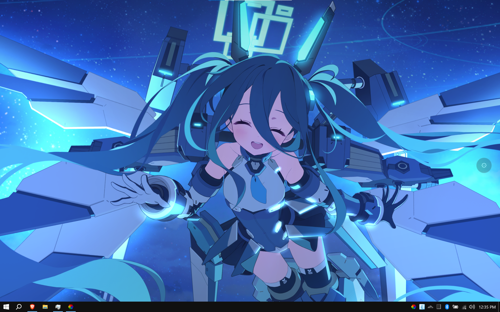
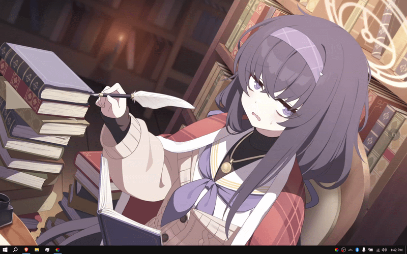

# Blue Archive Memorial Lobby Wallpaper

[](README.md)
[](README.vi.md)

[](https://hieucutevl.xyz)
[](https://hieucutevl.xyz)

Interactive 2D live wallpaper featuring over 280 Blue Archive students and variants. Built with PixiJS and Spine WebGL for Lively Wallpaper on Windows and modern web browsers.

## Features

- **Spine WebGL Animation**: Hardware-accelerated skeletal animation powered by PixiJS and Spine-Pixi v7.
- **Interactive Gaze and Touch**: Hold and drag to steer gaze; click for headpats, cheek pulls, and reaction animations.
- **280+ Students and Variants**: Searchable in-wallpaper student selector with instant live switching.
- **Dual Lively Wallpaper Support**: Run as a zero-install web URL or as a local package with native Windows tray controls.
- **Automatic Power Saver**: Suspends rendering when full-screen apps or games run to conserve CPU and GPU.
- **Responsive Scaling**: Adapts to 16:9, 16:10, and 21:9 ultrawide displays without distortion.
- **Pure Static Architecture**: Runs completely client-side. No build steps, dependencies, or backend servers required.

## Installation and Usage

### Method 1: Instant URL (Zero Download, Recommended)

Run this wallpaper in Lively Wallpaper directly from the web without downloading any files:

1. Open **Lively Wallpaper**.
2. Click **+ Add Wallpaper**.
3. Paste either URL into the **Enter URL** field:
   ```text
   https://hieucutevl2.github.io/BA_Memorial_Lobby/
   ```
   *(Mirror: `https://hieucutevl.xyz`)*
4. Click the arrow button to confirm.
5. Use the on-screen menu buttons on the right edge (gear and student icons) to switch students, change FPS, and adjust interaction settings.

### Method 2: Local Package (Full Windows Tray Integration)

1. Download or clone this repository to your computer.
2. Open **Lively Wallpaper**.
3. Click **+ Add Wallpaper**.
4. Click **Choose a file** and select `LivelyInfo.json` (or drag and drop the folder into Lively).
5. Right-click the wallpaper in your Lively library and select **Customize** to adjust settings directly from the Windows tray.

### Method 3: Run in Web Browser

Run any local static server from this directory:

```bash
# Python 3
python3 -m http.server 8080

# Or Node.js
npx serve .
```

Open `http://localhost:8080` in your browser.

## Controls

- **Steer Gaze**: Click and hold anywhere to make the character look towards your cursor.
- **Headpat**: Click or drag on the character's head or hair.
- **Cheek Pinch**: Click and drag on cheeks for stretch and poke reactions (supported students).
- **Talk Reaction**: Click on the body or background to trigger voice expressions and body animations.
- **Student Board**: Hover over the options button on the right edge and click the student board icon.
- **Settings Menu**: Click the gear button on the right edge to adjust interaction mode and frame rate (60 / 30 / 24 FPS).
- **Keyboard Shortcut**: Press `Escape` to close any open modal or dropdown.

## Project Structure

```text
├── index.html              # Main web page and UI modals
├── LivelyInfo.json         # Lively Wallpaper metadata and playback pause hooks
├── LivelyProperties.json   # Lively Wallpaper customize panel settings
├── README.md               # English documentation
├── README.vi.md            # Vietnamese documentation
├── LICENSE                 # License and third-party notices
├── js/
│   ├── main.js             # Core animation loop, Spine controllers, physics, and Lively IPC
│   └── students.js         # Comprehensive 280+ student and alt dataset
└── vendor/
    ├── pixi.min.js          # Bundled PixiJS v7 runtime
    └── spine-pixi-v7.min.js # Bundled Spine Pixi runtime
```

## Credits and Acknowledgements

- **Joe ([ba-tools](https://github.com/joexyz/ba-tools))**: Memorial Lobby renderer architecture, touch zone physics, and interaction design.
- **AronaBot / Nimblebun ([aronabot.cdn.nimblebun.works](https://aronabot.cdn.nimblebun.works))**: Memorial Lobby manifests, skeleton models, and asset CDN hosting.
- **SchaleDB**: Student database and game data references.
- **NEXON Games Co., Ltd. & Yostar, Inc.**: Blue Archive characters, art, and assets.
- **PixiJS & Esoteric Software**: WebGL rendering library and Spine runtime.

## Disclaimer and License

This is an unofficial, non-commercial fan project. Game assets, characters, and trademarks belong to **NEXON Games Co., Ltd.** and **Yostar, Inc.**

Source code is released under the [MIT License](LICENSE). Third-party libraries retain their respective licenses.
