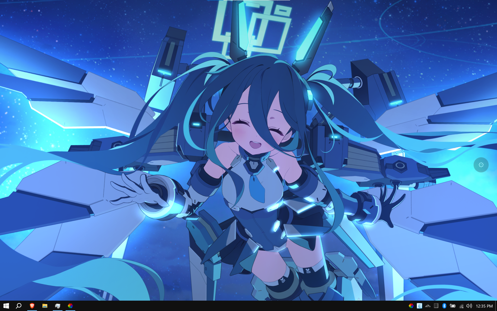

# Blue Archive Memorial Lobby Wallpaper

[](README.md)
[](README.vi.md)

[](https://hieucutevl.xyz)

Hình nền động 2D tương tác với hơn 280 học sinh Blue Archive và các trang phục biến thể. Xây dựng bằng PixiJS và Spine WebGL, tối ưu cho Lively Wallpaper trên Windows cũng như các trình duyệt web hiện đại.

## Tính năng

- **Hoạt ảnh Spine WebGL**: Hoạt ảnh khung xương tăng tốc phần cứng thông qua PixiJS và Spine-Pixi v7.
- **Tương tác ánh nhìn và chạm**: Nhấn giữ và kéo chuột để điều hướng ánh mắt; nhấp chuột để xoa đầu, véo má và kích hoạt phản ứng cử động.
- **Hơn 280 học sinh và biến thể**: Bảng chọn học sinh tích hợp sẵn thanh tìm kiếm và chuyển đổi trực tiếp tức thì.
- **Hỗ trợ Lively Wallpaper linh hoạt**: Chạy trực tiếp qua đường dẫn web không cần tải xuống hoặc cài đặt gói tệp cục bộ với bảng điều khiển khay hệ thống Windows.
- **Tự động tiết kiệm năng lượng**: Tự động tạm dừng hiển thị khi ứng dụng toàn màn hình hoặc trò chơi đang chạy nhằm tiết kiệm CPU và GPU.
- **Tự động co giãn theo màn hình**: Tương thích tốt với các tỉ lệ hiển thị 16:9, 16:10 và màn hình siêu rộng 21:9 mà không bị biến dạng.
- **Kiến trúc tĩnh hoàn toàn**: Chạy hoàn toàn phía máy khách (client-side). Không cần biên dịch, không phụ thuộc thư viện ngoài, không cần máy chủ backend.

## Cài đặt và Sử dụng

### Cách 1: Sử dụng URL Trực tiếp (Không cần tải xuống, Khuyên dùng)

Chạy hình nền trực tiếp trong Lively Wallpaper từ trình duyệt web mà không cần tải bất kỳ tệp nào:

1. Mở **Lively Wallpaper**.
2. Nhấp vào **+ Thêm hình nền** (Add Wallpaper).
3. Dán một trong hai đường dẫn sau vào ô **Nhập URL** (Enter URL):
   ```text
   https://hieucutevl2.github.io/BA_Memorial_Lobby/
   ```
   *(Đường dẫn dự phòng: `https://hieucutevl.xyz`)*
4. Nhấp nút mũi tên để xác nhận.
5. Sử dụng các nút bảng điều khiển ở cạnh phải màn hình (biểu tượng bánh răng và danh sách học sinh) để đổi học sinh, điều chỉnh FPS và các chế độ tương tác.

### Cách 2: Gói tệp cục bộ (Hỗ trợ khay hệ thống Windows)

1. Tải về hoặc nhân bản (clone) mã nguồn kho lưu trữ này về máy tính của bạn.
2. Mở **Lively Wallpaper**.
3. Nhấp vào **+ Thêm hình nền** (Add Wallpaper).
4. Nhấp **Chọn tệp** (Choose a file) và chọn tệp `LivelyInfo.json` (hoặc kéo thả cả thư mục vào Lively Wallpaper).
5. Nhấp chuột phải vào hình nền trong thư viện Lively và chọn **Tùy chỉnh** (Customize) để chỉnh cài đặt trực tiếp từ khay hệ thống Windows.

### Cách 3: Chạy trên Trình duyệt web

Khởi chạy bất kỳ máy chủ tĩnh cục bộ nào từ thư mục này:

```bash
# Python 3
python3 -m http.server 8080

# Hoặc Node.js
npx serve .
```

Mở địa chỉ `http://localhost:8080` trên trình duyệt web của bạn.

## Hướng dẫn thao tác

- **Điều hướng ánh nhìn**: Nhấn giữ chuột tại vị trí bất kỳ để nhân vật nhìn theo con trỏ chuột.
- **Xoa đầu (Headpat)**: Nhấp hoặc rê chuột trên đầu hoặc tóc của nhân vật.
- **Véo má**: Nhấp và kéo chuột trên má để kích hoạt cử động kéo giãn hoặc chọc má (đối với học sinh có hỗ trợ).
- **Phản ứng trò chuyện**: Nhấp vào thân nhân vật hoặc hình nền để kích hoạt biểu cảm lời thoại và cử động cơ thể.
- **Bảng chọn học sinh**: Rê chuột vào nút tùy chọn ở cạnh phải màn hình và nhấp vào biểu tượng danh sách học sinh.
- **Menu Cài đặt**: Nhấp biểu tượng bánh răng ở cạnh phải màn hình để chỉnh chế độ tương tác và tốc độ khung hình (60 / 30 / 24 FPS).
- **Phím tắt**: Nhấn phím `Escape` để đóng cửa sổ thông báo hoặc bảng danh sách đang mở.

## Cấu trúc dự án

```text
├── index.html              # Trang web chính và giao diện hộp thoại
├── LivelyInfo.json         # Siêu dữ liệu Lively Wallpaper và cấu hình tạm dừng hiển thị
├── LivelyProperties.json   # Cấu hình bảng tùy chỉnh trên Lively Wallpaper
├── README.md               # Tài liệu tiếng Anh
├── README.vi.md            # Tài liệu tiếng Việt
├── LICENSE                 # Giấy phép mã nguồn và thông cáo bên thứ ba
├── js/
│   ├── main.js             # Vòng lặp hoạt ảnh chính, bộ điều khiển Spine, vật lý và Lively IPC
│   └── students.js         # Cơ sở dữ liệu hơn 280 học sinh và trang phục
└── vendor/
    ├── pixi.min.js          # Thư viện PixiJS v7 đi kèm
    └── spine-pixi-v7.min.js # Thư viện Spine Pixi đi kèm
```

## Đóng góp và Ghi nhận

- **Joe ([ba-tools](https://github.com/joexyz/ba-tools))**: Kiến trúc trình dựng Memorial Lobby, vùng chạm vật lý và thiết kế tương tác.
- **AronaBot / Nimblebun ([aronabot.cdn.nimblebun.works](https://aronabot.cdn.nimblebun.works))**: Dữ liệu manifest Memorial Lobby, mô hình khung xương và CDN phân phối tài nguyên.
- **SchaleDB**: Cơ sở dữ liệu học sinh và tài liệu tham khảo dữ liệu trò chơi.
- **NEXON Games Co., Ltd. & Yostar, Inc.**: Thiết kế nhân vật, hình ảnh và tài nguyên Blue Archive.
- **PixiJS & Esoteric Software**: Thư viện kết xuất WebGL và Spine runtime.

## Tuyên bố miễn trừ trách nhiệm và Giấy phép

Đây là dự án phi thương mại do người hâm mộ phát triển. Tài nguyên trò chơi, hình ảnh nhân vật và nhãn hiệu thuộc bản quyền của **NEXON Games Co., Ltd.** và **Yostar, Inc.**

Mã nguồn dự án được phát hành theo [Giấy phép MIT](LICENSE). Các thư viện của bên thứ ba giữ nguyên giấy phép tương ứng của họ.
